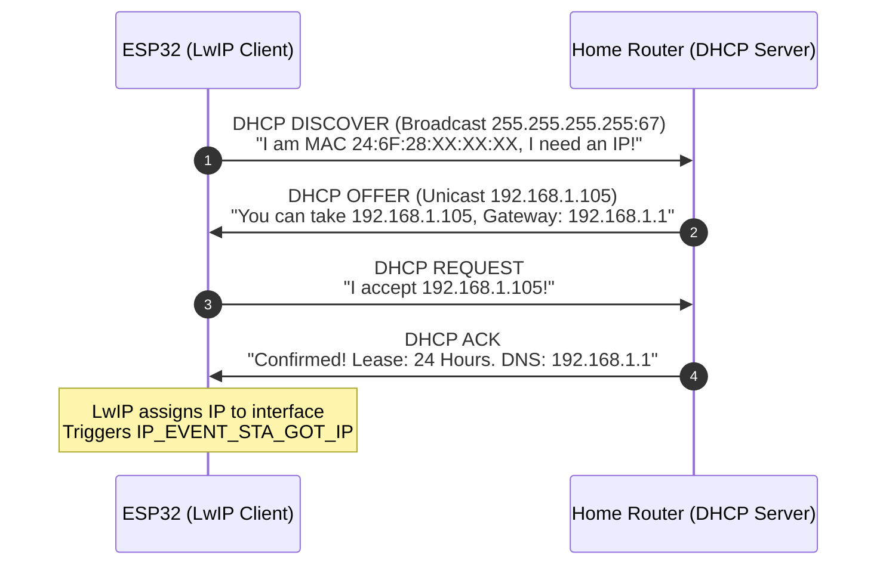
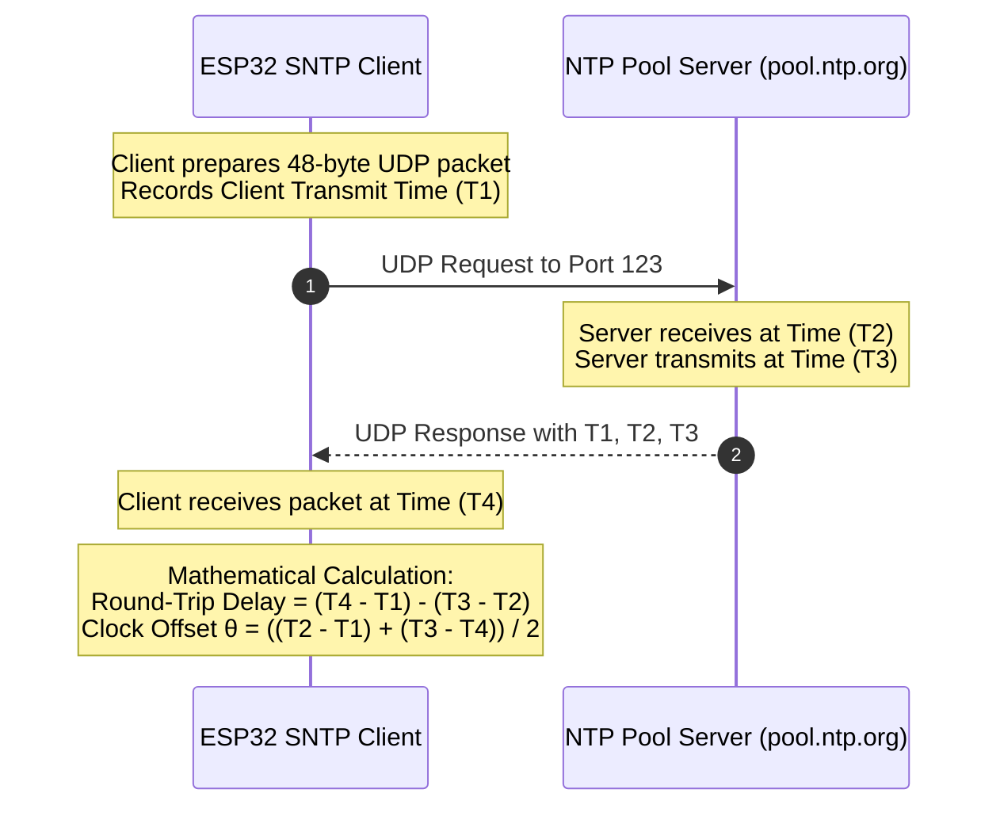
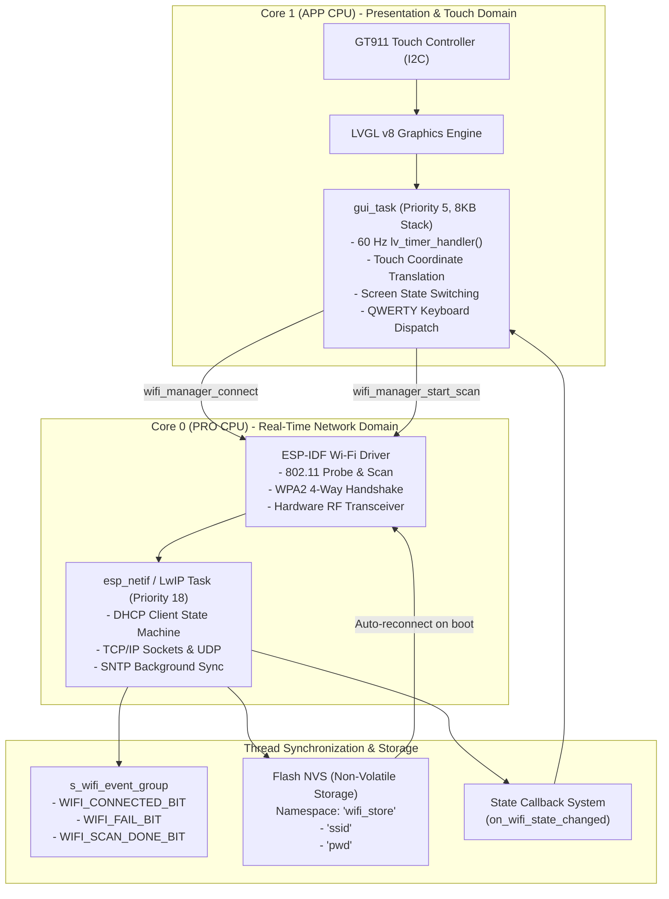

# ESP32 IoT Networking: Wi-Fi, TCP/IP, SNTP & Embedded Architecture Guide

---

## 1. Executive Overview & Mental Model Shift

If you are coming from traditional embedded protocols like **UART, SPI, and I2C**, networking requires a fundamental shift in how you think about firmware execution:

| Traditional Embedded Bus (SPI, I2C, UART) | Networked Embedded Systems (Wi-Fi, TCP/IP) |
| :--- | :--- |
| **Deterministic Timing**: You set clock registers, push bytes, and they clock out predictably in microseconds. | **Non-Deterministic / Asynchronous**: Packets travel over radio waves; packets drop, retry, take variable route times, or arrive out of order. |
| **Direct Hardware Access**: You write directly to peripheral FIFO registers and read pins. | **Layered Stack**: Hardware Radio $\to$ MAC Layer $\to$ IP Layer $\to$ Transport Layer $\to$ Application Sockets. |
| **Point-to-Point**: Master talks directly to one specific slave chip on a PCB. | **Routable & Switched**: Packets travel through access points, routers, modems, and the global Internet. |
| **State Tracking**: Simple boolean flags or small FSM states. | **Event-Driven Architecture**: The network stack emits asynchronous events (`WIFI_EVENT`, `IP_EVENT`) across threads. |

---

## 2. Layer 1 & 2: Wi-Fi (802.11) Physical & Data Link Fundamentals

```
                  ┌────────────────────────────────────────────────────────┐
                  │                 Application (SNTP, HTTP)               │
                  ├────────────────────────────────────────────────────────┤
                  │           Transport Layer (TCP / UDP Sockets)          │
                  ├────────────────────────────────────────────────────────┤
                  │              Network Layer (IPv4 / IPv6, DHCP)         │
                  ├────────────────────────────────────────────────────────┤
                  │           LwIP (Lightweight TCP/IP Stack in RAM)       │
                  ├────────────────────────────────────────────────────────┤
                  │  ESP32 Wi-Fi MAC & Physical Driver (FreeRTOS Core 0)   │
                  ├────────────────────────────────────────────────────────┤
                  │      2.4 GHz RF Transceiver & On-Board PCB Antenna     │
                  └────────────────────────────────────────────────────────┘
```

### 2.1 The 2.4 GHz RF Radio Spectrum
* The ESP32 integrates a $2.4\text{ GHz}$ RF synthesizer, power amplifier (PA), low-noise amplifier (LNA), and antenna switch.
* The $2.4\text{ GHz}$ band is partitioned into **Channels 1 to 13** (spaced $5\text{ MHz}$ apart, with each channel occupying $\approx 20\text{ MHz}$ bandwidth).
* Because channels overlap, Channels **1, 6, and 11** are the primary non-overlapping channels used by home and commercial routers.

### 2.2 Wi-Fi Operating Modes
The ESP32 Wi-Fi radio can operate in three distinct software modes:
1. **Station Mode (`WIFI_MODE_STA`)**:
   * The ESP32 acts as a **client device** (like your phone or laptop).
   * It scans for nearby Access Points (APs), associates with a router, receives an IP address, and communicates with the local network and the Internet.
   * *This is the mode implemented in our `ESP32_WIFI_IOT` project.*
2. **Soft Access Point Mode (`WIFI_MODE_AP`)**:
   * The ESP32 acts as a **router/hotspot**.
   * Other devices (phones, PCs) connect directly to the ESP32. It runs its own internal DHCP server to assign IP addresses to connected clients.
   * *Commonly used for device provisioning or offline direct control.*
3. **Station + SoftAP Concurrent Mode (`WIFI_MODE_APSTA`)**:
   * The radio switches time-slices between being a client to a home router and simultaneously acting as a setup hotspot.

### 2.3 What Actually Happens During a Wi-Fi Scan?
When you press `[ RESCAN ]` in [`wifi_ui.c`](file:///c:/C_notes/ESP32_Bringup/ESP32_WIFI_IOT/main/wifi_ui.c#L112), the firmware calls `wifi_manager_start_scan()`:
1. **Channel Hopping**: The ESP32 radio hops across Channel 1 through Channel 13 sequentially.
2. **Active vs Passive Scanning**:
   * **Active Scan (Our implementation)**: The ESP32 broadcasts a raw 802.11 **Probe Request frame** on each channel. Every router within range immediately replies with a **Probe Response frame** containing its SSID, signal strength, and supported encryption schemes.
   * **Passive Scan**: The ESP32 silently listens on each channel for periodic **Beacon frames** transmitted by routers every $100\text{ ms}$. Active scan is significantly faster ($\approx 1.2\text{ s}$ total vs $\approx 3.5\text{ s}$).
3. **Parsing the AP Records (`wifi_ap_record_t`)**:
   * **SSID**: The human-readable network name (up to 32 ASCII bytes).
   * **BSSID**: The physical 48-bit MAC address of the router radio.
   * **RSSI (Received Signal Strength Indicator)**: Measured in negative decibel-milliwatts ($\text{dBm}$).
     * $-30\text{ dBm} \dots -50\text{ dBm}$: Exceptional signal (router in same room).
     * $-60\text{ dBm} \dots -70\text{ dBm}$: Good, reliable connection.
     * $-80\text{ dBm} \dots -90\text{ dBm}$: Weak signal; packet loss likely.
   * **Authmode**: `WIFI_AUTH_OPEN`, `WIFI_AUTH_WPA2_PSK`, or `WIFI_AUTH_WPA3_PSK`.

### 2.4 The Connection Lifecycle: 4-Way WPA2 Handshake
When you tap your SSID, type your password, and click Connect:
1. **802.11 Authentication & Association**:
   * ESP32 sends an Authentication frame $\to$ Router confirms.
   * ESP32 sends an Association Request $\to$ Router returns Association ID (AID).
2. **The 4-Way EAPOL Handshake**:
   * The ESP32 and router **never send the actual Wi-Fi password across the radio waves**.
   * Instead, both devices combine the password with the SSID to derive a 256-bit **Pre-Shared Key (PSK)** using $4096$ iterations of PBKDF2 (HMAC-SHA1).
   * Through 4 cryptographic nonce exchanges, both ends prove they know the password and generate temporary session keys:
     * **PTK (Pairwise Transient Key)**: Encrypts unicast data between ESP32 and router.
     * **GTK (Group Temporal Key)**: Encrypts broadcast/multicast packets.
3. Once the 4-way handshake succeeds, the Wi-Fi data link is established, and the driver raises event: **`WIFI_EVENT_STA_CONNECTED`**.

---

## 3. Layer 3 & 4: The TCP/IP Stack & LwIP

Having a Wi-Fi link only means radio frames can travel between the ESP32 and the router antenna. You cannot send Internet data until the **Network Layer (IP)** and **Transport Layer (TCP/UDP)** are configured.

### 3.1 What is LwIP?
* A standard Linux/Windows TCP/IP stack requires tens of megabytes of RAM. The ESP32 has $\approx 520\text{ KB}$ of total internal SRAM.
* **LwIP (Lightweight IP)** is an open-source, highly optimized embedded TCP/IP stack designed to run in as little as $40\text{ KB}$ of RAM.
* In ESP-IDF, LwIP runs as a dedicated high-priority FreeRTOS background task (`esp_netif`).

### 3.2 DHCP: How the ESP32 Gets an IP Address
As soon as `WIFI_EVENT_STA_CONNECTED` fires, the LwIP DHCP client automatically broadcasts on the local subnet:



* **IP Address**: The unique identity of the ESP32 on your local subnet (e.g. `192.168.1.105`).
* **Subnet Mask**: Identifies which portion of the IP belongs to the local network (e.g. `255.255.255.0`).
* **Default Gateway**: The router's internal IP address (e.g. `192.168.1.1`), where all packets destined for the outside Internet are forwarded.
* **DNS (Domain Name System)**: Translates human domain names (`pool.ntp.org`) into numerical Internet IP addresses.

### 3.3 TCP vs UDP: Which One for What?
* **TCP (Transmission Control Protocol)**:
  * Connection-oriented, guarantees packet delivery, performs retransmissions, handles congestion.
  * Used for: Web browsing (HTTP/HTTPS), MQTT, WebSocket, firmware updates (OTA).
* **UDP (User Datagram Protocol)**:
  * Connectionless, fire-and-forget, ultra-low latency, zero handshake overhead.
  * Used for: **SNTP (time synchronization)**, DNS lookups, audio/video streaming.

---

## 4. Layer 7: SNTP (Simple Network Time Protocol)

### 4.1 The Embedded Clock Problem
* Standard microcontrollers do **not** have an onboard battery-backed Real-Time Clock (RTC) with calendar tracking.
* When the ESP32 powers on, its hardware microsecond counter starts counting from **$0$** (representing the UNIX epoch: `January 1, 1970, 00:00:00 UTC`).
* To display the actual calendar date and time, the ESP32 must synchronize with an atomic clock on the Internet.

### 4.2 How SNTP Works (RFC 4330)
**SNTP (Simple Network Time Protocol)** operates over **UDP on Port 123**:



1. The client records local timestamp $T_1$ and transmits a 48-byte UDP packet to `pool.ntp.org`.
2. The atomic NTP server stamps its receive time $T_2$ and reply time $T_3$.
3. The client receives the reply at timestamp $T_4$.
4. By calculating the clock offset $\theta$, the client cancels out the network propagation delay and computes the exact real-world time down to millisecond precision!
5. LwIP calls `settimeofday(&tv, NULL)`, which updates the ESP32 internal POSIX clock.

### 4.3 Timezones in Embedded C (`setenv("TZ", ...)`)
SNTP delivers time strictly in **UTC (Coordinated Universal Time)**. To convert UTC to your local wall-clock time:
```c
// Indian Standard Time is UTC + 5:30
// In POSIX standard, the sign represents the offset from local to UTC (inverted!):
setenv("TZ", "IST-5:30", 1);
tzset(); // Recomputes timezone conversion tables in C runtime
```
When you subsequently call `localtime_r(&now, &timeinfo)`, the C runtime automatically applies the $+5\text{h }30\text{m}$ offset, daylight savings adjustments, and populates `struct tm` (hours, minutes, seconds, day, month, year).

---

## 5. BLE (Bluetooth Low Energy) Primer: How It Differs from Wi-Fi

Since you mentioned wanting to understand BLE alongside Wi-Fi, here is the architectural comparison:

| Attribute | Wi-Fi (802.11 b/g/n) | Bluetooth Low Energy (BLE 4.2 / 5.0) |
| :--- | :--- | :--- |
| **Primary Goal** | High-throughput data streaming, Internet access. | Ultra-low power telemetry, peripheral control. |
| **Power Consumption** | High ($\approx 80\text{ mA} \dots 240\text{ mA}$ during TX/RX). | Ultra-low ($\approx 5\text{ mA} \dots 15\text{ mA}$, coin-cell battery). |
| **Data Rate** | Up to $72\text{ Mbps}$ (802.11n). | $1\text{ Mbps} \dots 2\text{ Mbps}$. |
| **Range** | $50\text{ m} \dots 100\text{ m}$. | $10\text{ m} \dots 30\text{ m}$. |
| **Network Topology** | Star network around an Access Point (IP based). | Point-to-point or Mesh (GATT Attribute based). |
| **Addressing** | IP Address (`192.168.1.50`). | 128-bit Service & Characteristic UUIDs. |

### The BLE Hierarchy: GAP & GATT
* **GAP (Generic Access Profile)**: Defines device roles:
  * **Broadcaster / Advertiser**: Beacons sending periodic broadcast packets without a connection (e.g. Apple AirTags).
  * **Peripheral**: Connectable device (e.g., smart watch, heart rate monitor, or ESP32).
  * **Central**: Initiates connections (e.g., smartphone).
* **GATT (Generic Attribute Profile)**: Organizes data into a hierarchical tree:
  * **Profile** $\to$ **Service** (Collection of features, e.g. "Battery Service" `0x180F`) $\to$ **Characteristic** (Specific variable, e.g. "Battery Level" `0x2A19`, 1 byte 0-100%).

> [!TIP]
> **The Classic IoT Industry Pattern (Wi-Fi Provisioning via BLE)**:
> How do smart bulbs or smart home appliances connect to your home Wi-Fi if they have no screen or keyboard?
> 1. On power-up, the ESP32 starts in **BLE Peripheral mode**.
> 2. You open an app on your phone, which connects to the ESP32 over BLE.
> 3. Your phone writes your home Wi-Fi SSID and Password into a BLE Characteristic.
> 4. The ESP32 saves the credentials in Flash NVS, shuts down BLE, and connects to your Wi-Fi router!

---

## 6. FreeRTOS & ESP-IDF Synchronization Architecture

The software architecture of our [`ESP32_WIFI_IOT`](file:///c:/C_notes/ESP32_Bringup/ESP32_WIFI_IOT) project decouples hardware rendering from network events across two CPU cores:



### 6.1 Why FreeRTOS Event Groups Instead of Queues?
In [`wifi_manager.c`](file:///c:/C_notes/ESP32_Bringup/ESP32_WIFI_IOT/main/wifi_manager.c#L18-L21), we define:
```c
#define WIFI_CONNECTED_BIT      BIT0
#define WIFI_FAIL_BIT           BIT1
#define WIFI_SCAN_DONE_BIT      BIT2
```
* **Why not a Queue?** A queue requires data serialization and can only be consumed once.
* **Why an Event Group?** Event Groups allow any number of tasks to sleep on **combinations of boolean flags** simultaneously (`xEventGroupWaitBits`).
* For example, a task can wait for `(WIFI_CONNECTED_BIT | WIFI_FAIL_BIT)` with a single API call, waking up as soon as *either* event occurs!

### 6.2 NVS (Non-Volatile Storage)
* When you enter your Wi-Fi password once, you do not want to re-type it every time you turn on the machine.
* The ESP32 partitions part of its external SPI Flash into an **NVS partition**.
* NVS stores key-value pairs (`"ssid"` and `"pwd"`) encrypted or in plain text with wear-leveling so repeated writes do not degrade the flash memory.
* On boot, `app_main()` checks NVS. If valid credentials exist, it **auto-connects immediately in the background** without prompting the user!

---

## 7. Interactive UI & User Experience Flow

The user interface in [`wifi_ui.c`](file:///c:/C_notes/ESP32_Bringup/ESP32_WIFI_IOT/main/wifi_ui.c) is organized into two primary states:

### Screen 1: The Wi-Fi Discovery & Setup Screen
```
┌──────────────────────────────────────────────────────────┐
│ Wi-Fi Network Setup                  [ ⟳ RESCAN ]        │
├──────────────────────────────────────────────────────────┤
│ ┌──────────────────────────────────────────────────────┐ │
│ │ 🔒 Home_Network_5G                  -48 dBm   [ > ]  │ │
│ │ 🔒 Office_Guest_WiFi                -65 dBm   [ > ]  │ │
│ │ 🔓 Public_Open_Hotspot              -82 dBm   [ > ]  │ │
│ │                                                      │ │
│ └──────────────────────────────────────────────────────┘ │
│                                                          │
│ Status: Scan complete. Tap a network to connect.   [☼]   │
└──────────────────────────────────────────────────────────┘
```
1. **The Scanned List (`lv_list`)**: Dynamically populated from radio scan results. Displays network names, security status (lock icon), and signal strength in $\text{dBm}$.
2. **The Password Modal & On-Screen Keyboard (`lv_keyboard`)**:
   * Tapping any secured network dims the background and pops up a modal dialog.
   * Attaches an on-screen QWERTY touch keyboard configured for capacitive touch on the GT911.
   * Tapping the checkmark key (or "Connect") passes the string to `wifi_manager_connect()`.

---

### Screen 2: The Connected IoT Clock & Telemetry Dashboard
Once the DHCP handshake completes and SNTP updates the clock, the UI automatically transitions to the live dashboard:

```
┌──────────────────────────────────────────────────────────┐
│ ● ONLINE                                 [ Disconnect ]  │
├──────────────────────────────────────────────────────────┤
│ ┌──────────────────────────────────────────────────────┐ │
│ │                                                      │ │
│ │                    14 : 35 : 02                      │ │
│ │                                                      │ │
│ │              Wednesday, 14 October 2026              │ │
│ │      ✓ SNTP Synced (pool.ntp.org - IST UTC+5:30)     │ │
│ └──────────────────────────────────────────────────────┘ │
│ ┌──────────────────────────────────────────────────────┐ │
│ │ SSID: Home_Network_5G                  RSSI: -48 dBm │ │
│ │ IP:   192.168.1.105                    GW: 192.168.1.1│
│ └──────────────────────────────────────────────────────┘ │
└──────────────────────────────────────────────────────────┘
```

* **Live Digital Clock**: Updated every $500\text{ ms}$ by `ui_periodic_timer()`.
* **Date Banner**: Extracted from POSIX calendar time.
* **Network Badge**: Displays live IP address and router gateway.
* **Disconnect Button**: Safely disconnects, flushes credentials, and returns to the scanner screen.

---

## 8. Summary Checklist & Golden Rules for Embedded Networking

1. **Never block inside an event handler**:
   * When `WIFI_EVENT` or `IP_EVENT` fires, you are executing in the context of the system event loop task. Never call `vTaskDelay()` or execute heavy computations inside the callback; set an event bit or post to a queue.
2. **Always feed the FreeRTOS IDLE task**:
   * Even when processing high-speed network traffic, ensure your tasks yield (`vTaskDelay(1)` or wait on semaphores) so that the background `IDLE` task can reset the Watchdog Timer (`task_wdt`).
3. **Respect RF Power Supplies**:
   * When the ESP32 Wi-Fi radio initiates a transmission, it draws instantaneous current spikes of up to **$300\text{ mA} - 500\text{ mA}$**. Always ensure adequate decoupling capacitors ($10\ \mu\text{F} + 0.1\ \mu\text{F}$) close to the $3.3\text{V}$ rail to prevent brownouts.
4. **Timezone Signs**:
   * In POSIX C runtimes, `TZ="IST-5:30"` means **positive offset UTC+5:30**. Do not put `+5:30`, as that would set you to UTC-5:30!

---

*Project implemented and verified in [`ESP32_WIFI_IOT`](file:///c:/C_notes/ESP32_Bringup/ESP32_WIFI_IOT).*

